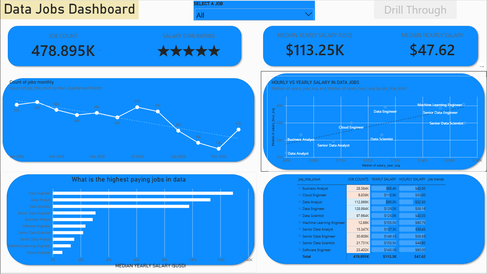
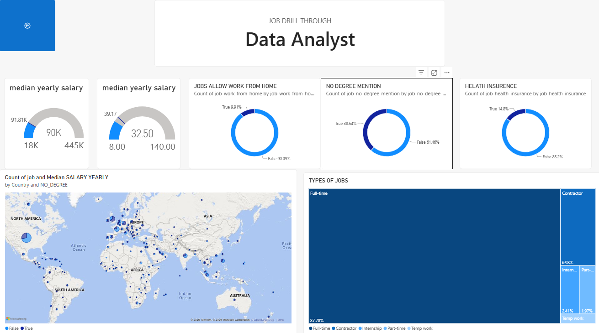

# 📊 My Power BI Dashboard Portfolio

Welcome to my **Power BI Dashboard Portfolio!**

This repository showcases my journey in data analytics through interactive Power BI dashboards, ranging from foundational data exploration to advanced, insight-driven analysis. Each project demonstrates my ability to transform raw data into meaningful visualizations and actionable business insights.

## 🚀 Featured Dashboards

Explore my Power BI projects below. Each dashboard has its own dedicated README with detailed information about the project objectives, data preparation, modeling, and key features.

---

## 📉 1. Data Jobs Dashboard (V1 — Comprehensive Exploration)

**An interactive dashboard for exploring the data job market and analyzing job-related trends.**

### 🌐 Dashboard Preview

### 🛠️ Key Power BI Skills

- 🎨 Dashboard Layout and Design
- ⚙️ Power Query — ETL and Data Transformation
- 🔗 Basic Data Modeling and Table Relationships
- 🧮 Implicit Measures and Standard Aggregations
- 📊 Core Visualizations — Bar, Line, Area, and Column Charts
- 🗺️ Map Visualizations for Geospatial Analysis
- 🔢 KPI Cards and Detailed Data Tables
- 🖱️ Interactive Slicers and Data Filtering
- 🔘 Buttons and Bookmarks for Page Navigation
- ➡️ Drill-Through Functionality

---

# 🎯 Data Analyst Job Drill-Through Dashboard

## 📌 Overview
An interactive Power BI report page for exploring Data Analyst job opportunities, salaries, benefits, and employment trends using drill-through functionality.

## 🖼️ Dashboard Preview

## 📊 Key Features

- 💰 **Salary Analysis:** Median yearly and hourly salary benchmarks.
- 🏠 **Remote Work:** Comparison of work-from-home opportunities.
- 🎓 **Degree Requirements:** Analysis of degree mentions in job postings.
- 🏥 **Health Insurance:** Overview of insurance mentions.
- 🌍 **Geographic Analysis:** Job distribution and salary by country.
- 💼 **Job Types:** Full-time, contract, internship, part-time, and temporary roles.

## 🛠️ Power BI Skills
- Power Query and data transformation
- Data modeling and relationships
- KPI cards and interactive visualizations
- Drill-through filters and page navigation
- Maps, doughnut charts, and treemaps

## 🎯 Objective
To transform job posting data into interactive visual insights that help users explore salary trends, benefits, and Data Analyst career opportunities.

- 🎨 Advanced Dashboard Design and Single-Page User Experience
- ⚙️ Complex Power Query Transformations
- 🔗 Star Schema Data Modeling
- 🧮 Explicit DAX Measures and
